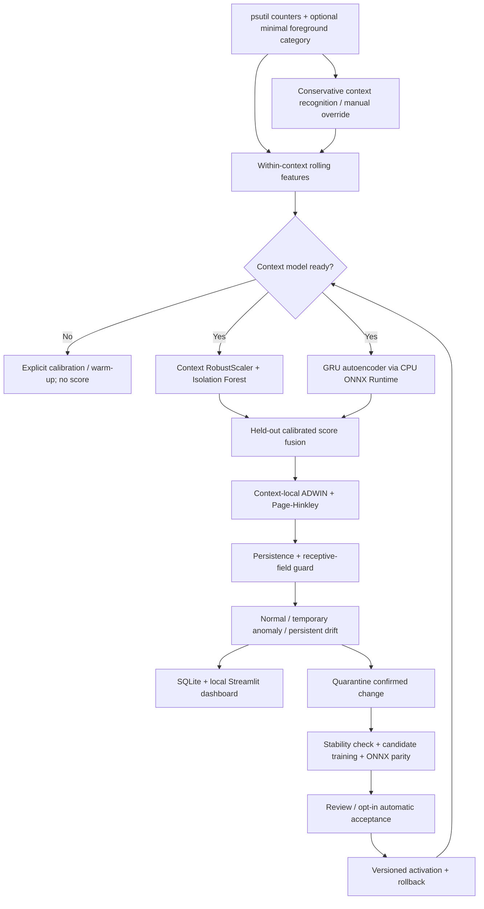

# Architecture and algorithm

## Modules and lifecycle

`collector` handles start/stop, CPU priming and monotonic counter deltas. `context` maps executable basenames to categories and applies conservative inference. `features` derives a 27-dimensional, numerical within-context window. `profiles` coordinates labelled calibration, scaling, training, thresholds and immutable version directories. `detection` supplies Isolation Forest, GRU training, score fusion, River detectors and the state machine. `inference` supplies CPU ONNX sessions. `adaptation` manages quarantined candidates. `storage` provides SQLite transactions and repositories. `privacy` controls deletion. `engine` is the synchronized shared pipeline used by Streamlit and CLI.

One daemon monitor thread owns telemetry production. A stop event makes waiting interruptible. An RLock serializes model/control operations and observations. An OS file lock prevents simultaneous collectors or destructive maintenance across processes. SQLite connections are short-lived with WAL, foreign keys and a ten-second busy timeout. Background exceptions stop monitoring and surface a sanitized error; scores are never invented after failure.

## Calibration and scoring

Each context trains only after at least 240 approved observations by default. The first 60% form the training partition. A purge gap of `feature_window + sequence_length` observations separates it from the later held-out partition. Temporal sequences never cross calibration session IDs, context changes or missing-data gaps. At least 20 contiguous training sequences and 50 held-out sequences are required.

The training partition fits a RobustScaler (10th–90th percentile range) and a 100-tree, single-threaded Isolation Forest. A GRU encoder (hidden width 16), recurrent decoder and linear projection learn normal sequence reconstruction for 18 epochs using Adam and clipped gradients. Sequence length is 12 by default. The exported ONNX graph fixes batch size 1 and sequence length; inference uses one CPU thread. Twelve held-out sequences must meet `atol=1e-5`, `rtol=1e-4` against PyTorch or training fails.

For an observed raw model score `s`, the training-reference upper-tail rank is `(1 + count(reference >= s)) / (n + 1)`. Negative logarithms produce evidence values. Isolation and reconstruction evidence are averaged with a configurable weight (default 0.5). The combined evidence is **recalibrated against the untouched validation distribution**, accounting empirically for dependence between models without assuming independent p-values. Final anomaly score is `1 - p_validation`; the nominal cutoff is `1 - alpha` (0.95 by default). Ties are conservative and finite-sample ranks never produce p=0. Correlated temporal data prevents a formal exchangeability guarantee.

During sequence warm-up, a trained Isolation Forest uses its own held-out calibration distribution. This method is explicitly named in each record. If no trained profile exists, ContextEdge reports uncalibrated status, not a prediction. Corrupt/checksum-mismatched or feature-schema-incompatible artifacts fail closed. Changing the feature window invalidates scoring until retraining.

## Context transitions and drift

Context switches clear rolling features and sequence buffers. Each context owns separate detector state; switching away closes its episode, and returning starts fresh persistence from its own model validation reference. Long observation gaps and missing critical metrics also end continuity. No scores from another context enter that detector. Grace suppresses alerts for the first four ready observations after context/model changes.

Actual River ADWIN and upward Page-Hinkley receive bounded anomaly evidence, initialized with the profile's normal validation score distribution. Configurable confirmation supports either detector, both, or one named detector. Detector signals latch for the configured persistence horizon so a momentary change-point signal can be combined with later sustained evidence.

An above-threshold observation starts a provisional temporary-anomaly episode. Consecutive abnormal observations accumulate persistence time. Recovery closes the episode as temporary unless it was already confirmed drift. A drift decision requires a detector confirmation **and** at least `min_persistence + feature_window + sequence_length - 2` consecutive abnormal observations. The latter guard accounts for the finite propagation of a spike through overlapping windows. With defaults this is 30 observations, imposing a conservative delay of at least about 58 seconds after the first abnormal score. The window/ratio gate and confirmation horizon add safeguards; strict recovery resets mean the default mechanism is conservative about intermittent shifts.

The displayed drift score is a bounded progress/evidence index, not a learned probability. Decisions persist their reason, time, context, version, duration and method. An event becomes persistent by upgrading its existing episode, rather than generating a duplicate alert for every sample.

## Adaptation

Confirmed drift starts an in-memory quarantine. Its observations do not enter the normal calibration table. Recovery, context loss, interruption or monitoring stop discards incomplete continuity and records the reason. Candidate staging requires 240 contiguous quarantined observations and a stability score no greater than 0.8. Stability compares the two half-window feature means divided by observed feature standard deviation (floor 0.1), then uses the 90th percentile across dimensions. This is a documented heuristic, not proof that a change is desirable.

A stable candidate runs the same chronological train/holdout/ONNX checks and is saved as a new version. The old baseline remains active until user acceptance, or until an explicitly enabled automatic policy accepts it. Candidate metadata retains quarantine provenance. Activation, rejection, interruption and rollback remain auditable. Adaptation time includes collection and review. No high-scoring sample is automatically appended to approved calibration data.

## Proposal alignment

The ten-page supplied proposal defines the same telemetry → context → baseline → anomaly → persistence → adaptation pipeline and technology stack. Its illustrative score readout is not used as application data. No result is attributed to its bibliography without verification. The implemented context recognizer is a privacy-minimized heuristic/foreground adapter; a supervised context classifier is deferred until suitable labelled local activity data exists.
